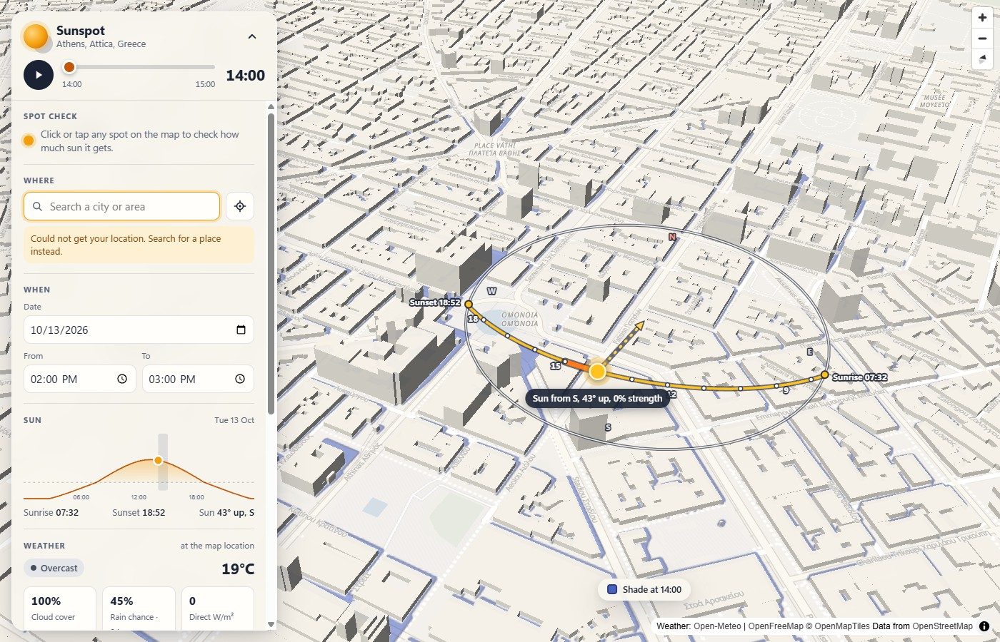
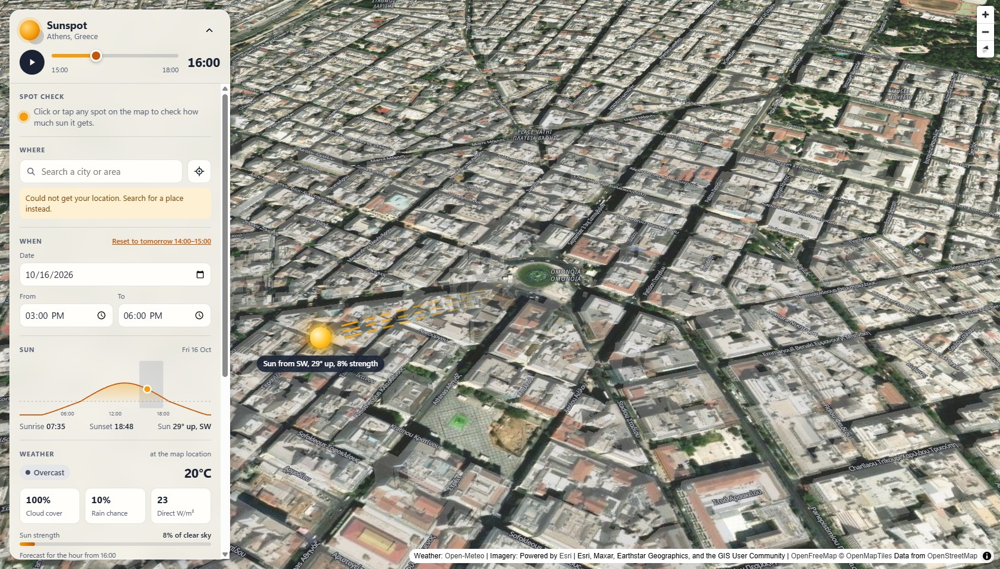
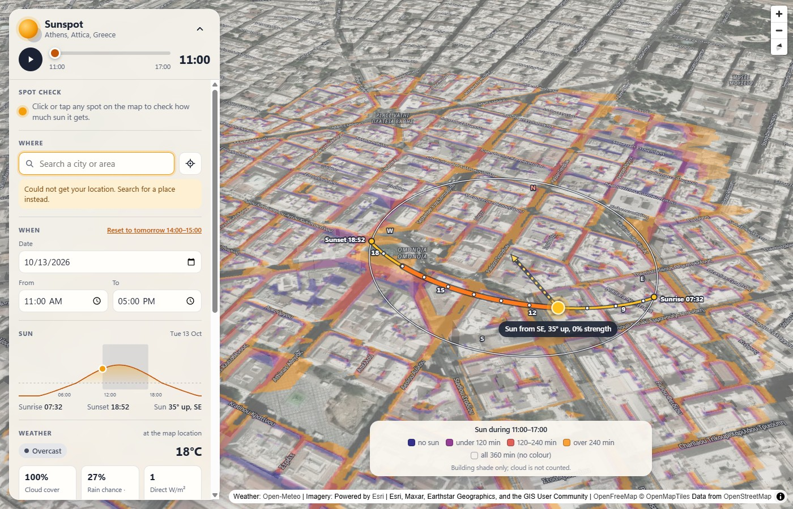

# Sunspot

A sunlight planner on a 3D map. Pick a place, a date and a time window, and
Sunspot shows where building shadows fall during that window, what the weather
forecast says, and whether a spot you click gets direct sun.

It runs entirely in the browser. There is no backend, no API key and no paid
service, so it costs nothing to host.

## What it does

- 3D map with extruded buildings. It opens on your location, or on Athens if
  location access is unavailable. Search for any place, or use the locate button.
- Date and time-window inputs (default: tomorrow, 14:00 to 15:00). A slider
  steps through the window in 5-minute steps and can play as an animation.
- Building shadows drawn on the ground for the slider's time, recomputed for the
  buildings in view whenever the map stops moving. Shadows fade under cloud.
- Weather for the slider's hour: cloud cover, rain chance, direct radiation,
  temperature, a label (Sunny, Partly sunny, Overcast or Rainy) and the sun's
  strength compared with a clear sky.
- Click any spot for a result card with two numbers: **geometric sun** (minutes
  clear of building shadows) and **effective sun** (those minutes weighted by
  how much direct beam the weather lets through). It also shows the sun's
  altitude and bearing at the start and end, the weather label for each hour of
  the window, and a verdict such as "Clear of shadows for 40 of 60 min, but
  cloud cuts the sun to 28% of clear-sky strength, so the light is mostly
  diffuse: only about 11 min of direct sun."
- Sunrise, sunset and the sun's height through the day.
- A **start place**. The first time it opens, the app asks where the map should
  open from then on: wherever you are, or one place you pick. The answer is
  kept on the device (`sunspot:start` in `localStorage`) and can be changed
  under "Where".
- A **Map / Satellite** switch. Map is a quiet drawn basemap with no shop or
  restaurant icons. Satellite puts a real aerial photo under the computed
  shadows, with an opacity slider so the shadows stay readable.
- A **sun path** drawn on the map: the sun's arc for the day from sunrise to
  sunset with the hours marked, the selected window highlighted, and the sun
  itself with an arrow showing where its light comes from and a label such as
  "Sun from SW, 25° up, 48% strength". It turns with the map and moves with the
  slider.
- Optional map layers, remembered between visits: a **sun-hours map** that
  colours the ground by how long it is in the sun during your time window, and
  **3D terrain** with hillshade.
- A sky that follows the time of day, and building light that comes from where
  the sun actually is.

| Map | Satellite |
| --- | --- |
|  |  |

Omonia, Athens, same view and time (14:00) in both basemaps.



The same view with **Sun hours** on, for an 11:00 to 17:00 window.

## How it works

| Part | Source |
| --- | --- |
| Map rendering | [MapLibre GL JS](https://maplibre.org/) |
| Tiles and style | [OpenFreeMap](https://openfreemap.org/) "liberty" style, OpenMapTiles schema, data from OpenStreetMap |
| Sun position | [suncalc](https://github.com/mourner/suncalc) |
| Satellite imagery (optional) | [Esri World Imagery](https://www.arcgis.com/home/item.html?id=10df2279f9684e4a9f6a7f08febac2a9) |
| Terrain (optional) | [AWS Terrain Tiles](https://registry.opendata.aws/terrain-tiles/), Mapzen terrarium elevation tiles |
| Forecast | [Open-Meteo forecast API](https://open-meteo.com/en/docs) |
| Place search | [Photon](https://photon.komoot.io) by komoot (OpenStreetMap data: cities, streets and addresses, in any language); falls back to the [Open-Meteo geocoding API](https://open-meteo.com/en/docs/geocoding-api) (cities only) if Photon is unreachable |
| Geometry | [turf](https://turfjs.org/) (union, point-in-polygon) |

### Shadow maths

Shadows are computed in the app (`src/lib/sun.ts`, `src/lib/shadow.ts`); no
shadow plugin is involved. Buildings are treated as flat-roofed prisms standing
on flat ground.

1. **Sun direction.** SunCalc 1.x reports azimuth measured from **south**,
   positive toward the west, in radians. A compass bearing starts at north and
   runs clockwise, so

   ```
   sunBearing = (azimuth in degrees + 180) mod 360
   ```

   suncalc is pinned to 1.9.0 because 2.x changed this convention (north-based
   degrees). A unit test checks the conversion, and another checks that the
   Athens sun is in the east in the morning and the south at noon.

2. **Shadow length.**

   ```
   length = height / tan(altitude)
   ```

   capped at 300 m when the sun is very low. If the altitude is zero or
   negative, there is no shadow.

3. **Shadow direction.** Directly away from the sun:
   `shadowBearing = sunBearing + 180`. The tip of the shadow is displaced
   `length * sin(shadowBearing)` metres east and `length * cos(shadowBearing)`
   metres north, converted to degrees with a local flat-earth approximation.

4. **Shadow polygon.** The shadow of a prism is its footprint swept along that
   displacement. That equals the footprint plus one quad per *leading* wall (a
   wall facing the way the shadow falls), swept along the displacement. Trailing
   walls and the translated roof outline add nothing, because any shaded point
   outside the footprint is reached through a leading wall. For convex
   footprints the convex hull of the footprint and its translated copy gives the
   same shape and is used as a fast path; concave footprints use the turf union
   of the pieces.

5. **Building height.** `render_height` or `height` from the tiles, else
   `levels * 3 m`, else a 12 m fallback (`FALLBACK_BUILDING_HEIGHT_M`).

6. **Point in shade.** A point is shaded if it is inside any building's shadow
   polygon, ignoring the building the point itself stands in. In code this is
   tested without building the polygon: the point is shaded when a line from it
   toward the sun, as long as the shadow, touches the footprint. A test checks
   that both give the same answer. The click analysis
   samples the window every 5 minutes; each sample is direct sun, building shade,
   or sun below the horizon (counted as no sun).

### Drawing the shadows

Merging every shadow in view with a polygon union takes a second or more per
frame in a dense city, which is too slow for the slider. So the shade is
**painted** instead (`src/lib/shadowCanvas.ts`): every shadow piece is filled
in one solid colour on an off-screen canvas, which merges overlaps for free,
and the map shows that canvas as a single picture laid on the ground.

- The shade is **blue with a dark outline**, a colour no aerial photo
  contains, so it cannot be mistaken for a shadow in the picture.
- Its strength is **constant** (46% on the map, 62% on satellite). Where shade
  falls is geometry, so cloud never fades it; how strong the sun is shows in
  the weather panel and the sun label.
- **Only the ground is shaded.** Building outlines are cut back out of the
  picture, otherwise every roof would be painted and a city block would read as
  one blue slab.
- A legend on the map says which time the shade is drawn for.

Exact per-building polygons (with the union) are still used for the click
analysis, where only nearby buildings matter.

Shadows are drawn from zoom 15 up, for at most 1,500 buildings nearest the map
centre. Which ones those are is worked out once per map move, not per slider
step. Measured on a desktop GPU (RTX 2060, 929 x 909 window) in central
Athens: about 33 to 37 ms per slider step.

### Cloud-aware sunlight (sunFactor)

Being clear of building shadows is not the same as being in the sun, so each
forecast hour gets a **sunFactor** between 0 and 1 (`src/lib/sunFactor.ts`):

```
sunFactor = forecast direct_radiation / clear-sky direct radiation
```

clamped to 0..1. The clear-sky value is an estimate for the sun's height at the
middle of that hour (Meinel model):

```
airMass      = 1 / sin(altitude)
directNormal = 1361 W/m2 * 0.7 ^ (airMass ^ 0.678)
clearSky     = directNormal * sin(altitude)      (on a horizontal surface)
```

If the forecast has no direct radiation, or the clear-sky value is under
30 W/m2 (sun below about 3 degrees, where the ratio is noise), the fallback is

```
sunFactor = 1 - cloud_cover / 100
```

sunFactor is used in three places:

- **Sun label.** The "48% strength" next to the sun on its path is the
  sunFactor of the slider's hour.

- **Weather label.** Sunny, Partly sunny or Overcast by sunFactor alone (see the
  thresholds above).

- **Effective sun minutes.** Each 5-minute sample counts `5 * sunFactor` if it
  is clear of shadows and 0 otherwise. Forty unshaded minutes at sunFactor 0.3
  are 12 effective minutes.
### Which forecast row each number comes from

Open-Meteo's hourly variables use two conventions, and `parseHourly` in
`src/lib/openMeteo.ts` reads each one so that it describes the hour starting at
the timestamp:

| Variable | Open-Meteo convention | Row read for the hour starting at row i |
| --- | --- | --- |
| `cloud_cover` | instantaneous at the timestamp | i |
| `temperature_2m` | instantaneous at the timestamp | i |
| `direct_radiation` | mean of the preceding hour | i + 1 |
| `shortwave_radiation` | mean of the preceding hour | i + 1 |
| `precipitation` | sum of the preceding hour | i + 1 |
| `precipitation_probability` | chance in the preceding hour | i + 1 |

So for "14:00" the radiation and rain figures cover 14:00 to 15:00, while cloud
cover and temperature are the values at 14:00. A unit test with a fixture pins
every variable to its row. The 23:00 hour has no following row on a one-day
request, so its radiation and rain are unknown and its sunFactor falls back to
cloud cover.

### Map layers and look

**Basemap switch** (Map is the default; the choice is remembered).

- **Map.** The OpenFreeMap "liberty" style, restyled after it loads
  (`src/lib/basemap.ts`) so that shadows and sunlight are the visual focus:
  every point-of-interest layer (shops, restaurants, offices) is hidden, along
  with one-way arrows, road shields and airport icons; bus stops are hidden,
  rail and metro stations stay, small and pale; street names stay, small and
  low-contrast; land, water, roads and rail are recoloured to light neutrals.
- **Satellite.** Esri World Imagery as a raster layer above the drawn land and
  roads and below the sun-hours map, the shadows, the buildings and the labels.
  The 3D buildings turn into faint glass boxes so the real roofs show, and the
  labels switch to white with a dark halo. A **Photo strength** slider (30% to
  100%, default 85%) controls the photo. Up to 85% the photo is also muted
  (greyer, flatter, lighter) so the shadows frozen into it recede behind the
  computed blue shade; from there to 100% the muting eases off, and 100% shows
  the untouched photo. The imagery tiles are only requested once Satellite is
  switched on.

**Toggles.**

- **Sun path** (on by default). A sky dome seen from above, laid on the ground
  in the middle of the free part of the map (`src/lib/sunPath.ts`). The ring is
  the horizon and its centre is straight overhead: the sun is drawn in its
  compass direction, on the ring at 0° and evenly closer to the centre as it
  climbs (30° up is two thirds of the way out). The yellow line is the whole
  day from sunrise to sunset, with a dot on every hour and a number on every
  third; the thick orange stretch is the selected window. The sun moves along
  it with the slider, and a dotted arrow runs from it to the centre, the way
  the light travels. Every point is a real ground position projected to the
  screen, so the drawing turns and tilts with the map. The label gives compass
  direction, height above the horizon and sunFactor. When the sun is down the
  path stays and the sun is left out.
- **Sun hours** (off by default). Colours the ground by how long it is clear
  of building shadows during the selected time window (`src/lib/sunHours.ts`).
  The window is sampled every 5 minutes (at most 13 samples; longer windows are
  sampled more coarsely). The shade for each sample is painted solid on a
  scratch canvas and added to the picture at 1/N strength, so each pixel's
  opacity ends up as the share of the window it was shaded. That share is then
  turned into one of five bands: no sun (indigo), under a third of the window
  (purple), a third to two thirds (coral), over two thirds (orange), and sun
  the whole time, which is left **without colour** so open ground does not
  turn the map into one flat tint. A legend gives the bands in minutes. While
  it is on, the blue shade for the slider's time stays visible, drawn over the
  colours, and still moves with the slider; the colours do not. It counts building shade
  only: cloud is not included, and a sample with the sun below the horizon
  counts as shade. It is repainted when the map or the window changes (about a
  quarter of a second on the test machine), not on slider steps.
- **3D terrain** (off by default). Elevation tiles drive both the terrain mesh,
  at true scale, and a hillshade layer lit from the sun's bearing. The tiles are
  requested only once the layer is switched on. Shadows are still computed for
  flat ground; the shade picture is draped over the terrain. See the
  accuracy note under Known limitations.

Other details: the sky colours switch between day, golden hour and night,
buildings are lit from the sun's real bearing and height, the map renders at
the screen's `devicePixelRatio`, and the camera can pitch up to 85 degrees.

Settings are stored in `localStorage`: `sunspot:basemap`,
`sunspot:imagery-opacity`, `sunspot:sun-direction`, `sunspot:sun-hours`
and `sunspot:terrain`.

### Satellite imagery and the Esri key

The Satellite basemap uses Esri World Imagery (`src/lib/imagery.ts`).

- **Without a key** (the default) tiles come from
  `server.arcgisonline.com`. This works out of the box and is meant for local
  development and personal use.
- **With a key**, set `VITE_ESRI_KEY` and every tile request goes to
  `ibasemaps-api.arcgis.com` with `?token=<key>` appended. Esri's terms expect
  public sites to use an ArcGIS account, so do this before publishing a site
  that offers the Satellite basemap.

To set the key locally, copy `.env.example` to `.env.local` and fill it in:

```
VITE_ESRI_KEY=your-key-here
```

For the GitHub Pages build, add a repository secret named `VITE_ESRI_KEY`
(**Settings > Secrets and variables > Actions**); the deploy workflow passes it
to the build, and builds without the secret simply stay keyless.

Getting a key: create a free account at
[developers.arcgis.com](https://developers.arcgis.com/), create an API key with
the basemap (location services) privilege, and **restrict it to your site's
address as an allowed referrer**. The key is compiled into the public site, so
anyone can read it; the referrer restriction is what stops others from using it.

### Weather label thresholds

The label is derived from two numbers only: the hour's sunFactor (below) and its
rain chance. The thresholds are constants in `src/lib/weatherLabel.ts`, checked
in this order:

| Label | Rule |
| --- | --- |
| Rainy | rain chance >= 60% |
| Sunny | sunFactor >= 0.7 |
| Partly sunny | sunFactor >= 0.3 |
| Overcast | anything lower |

Because the label and the "sun strength" figure come from the same sunFactor,
they cannot disagree. Thin high cloud that covers the sky but lets most of the
beam through counts as sunny, and the cloud cover percentage is shown separately.

### Time zones

Dates and times are wall-clock values in the selected place's timezone (default
Europe/Athens). The timezone comes from the search result, or from Open-Meteo
for a location or clicked point. The forecast is requested with
`timezone=auto`, so its hours are already local. Local times are converted to
UTC instants only for the sun calculations (`src/lib/time.ts`).

### Caching

Forecast responses are cached in memory per (latitude, longitude, date), with
coordinates rounded to 0.01 degrees. The cache lasts until the page reloads.

### Saved places and offline use

**Save this place for offline** (under "Where") keeps everything needed for
the area about 1.2 km around the middle of the map on the device:

- the **map tiles** covering it at every zoom (they carry the buildings, so
  shade, the sun path and sun hours all work, for any date and time);
- the map's **style, icons and fonts** (Latin, Greek and punctuation);
- the **forecast** for today and the next six days.

A saved place is about 3 to 6 MB in a city. Saved places are listed under the
button; tapping one opens it, and removing one deletes its files except those
another saved place still needs.

How it works (`src/lib/mapCache.ts`, `src/lib/offlineArea.ts`,
`src/lib/savedPlaces.ts`): every request to the map's tile server is rewritten
to a custom `ofm://` address and answered by a MapLibre protocol handler that
looks in the browser's Cache Storage first.

| File | Order |
| --- | --- |
| Map tiles, fonts, icons | Device first, then the network |
| Style and tile index | Network first (so a new map release is noticed), device if the network does not answer within 2.5 s |

There are two stores: **saved** (files of saved places, only removed with the
place) and **recent** (whatever the map loaded lately, the oldest dropped
beyond 600 files). Tiles are stored without the release date that is part of
their address, so a place saved under one map release is still found after the
server moves to the next. The **recent** store is also why the map opens faster
the second time: an area you have looked at is drawn from the device.

Forecasts are kept as they are fetched. When the network does not answer, the
kept copy is used and the weather panel says when it was saved.

Not available offline: areas that were not saved, the search, the satellite
photo (Esri's terms do not allow storing it), terrain, and labels in scripts
other than Latin and Greek. A saved forecast only covers the seven days from
the day it was saved. Storage belongs to the browser or the app: clearing site
data, or uninstalling the app, removes saved places.

## Setup

Requires Node.js 20 or newer.

```bash
npm install
npm run dev
```

Then open the URL Vite prints (http://localhost:5173 by default).

## Scripts

| Command | What it does |
| --- | --- |
| `npm run dev` | Start the dev server |
| `npm run build` | Type-check and build to `dist/` |
| `npm run preview` | Serve the production build locally |
| `npm test` | Run the unit tests once (Vitest) |
| `npm run test:watch` | Run the tests in watch mode |
| `npm run typecheck` | Type-check only |
| `npm run lint` | Lint with oxlint |
| `npm run build:android` | Build the web app for the APK and copy it into `android/` |
| `npm run icons` | Redraw the app icon and regenerate every Android icon and splash size |

The tests cover the azimuth conversion, shadow length and direction, shadow
polygons, the point-in-shade test, the weather label rules, sunFactor and the
clear-sky estimate, effective sun minutes, the verdict wording, timezone
handling and the click analysis.

## Deployment to GitHub Pages

`.github/workflows/deploy.yml` tests, builds and deploys on every push to
`main`.

1. Push the repository to GitHub.
2. In the repository, open **Settings > Pages** and set **Source** to
   **GitHub Actions**.
3. Push to `main` (or run the workflow by hand from the **Actions** tab).

The site appears at `https://<user>.github.io/<repo>/`. The workflow passes the
repository name to Vite as `BASE_PATH`, which `vite.config.ts` uses for `base`,
so asset URLs are correct under that sub-path without editing any file. For a
custom domain or a user page served from `/`, remove the `BASE_PATH` line.

GitHub Pages is free for public repositories. For a private repository it needs
a paid GitHub plan.

## Android app

The Android app is the same web build packed into an APK with
[Capacitor](https://capacitorjs.com): the files of `dist/` travel inside the
APK and are shown in a full-screen WebView. There is no second codebase. The
native project lives in `android/`, and `capacitor.config.ts` names the app
(`io.github.erikfazlla.sunspot`).

**What works without a connection:** the app itself opens, because its code is
inside the APK, and so does every place saved with "Save this place for
offline" (see "Saved places and offline use" above). Unsaved areas, the search
and the satellite photo need a connection.

**Icon.** `scripts/make-app-icons.mjs` draws the icon (a sun, a building seen
from above and its blue shade) and `npm run icons` regenerates every Android
size from it.

### Building it on your machine

You need the Android SDK and a full **JDK 21** (the JDK must include `jlink`;
a bare Java runtime is not enough).

```bash
npm run build:android
cd android
./gradlew assembleDebug
```

The APK appears in `android/app/build/outputs/apk/debug/`. `build:android`
builds with `--base=./`, because inside the APK the files sit next to
`index.html` rather than under `/sunspot/`.

### Building it on GitHub

`.github/workflows/android.yml` builds the APK on GitHub's machines:

- **Run it by hand** from the **Actions** tab to get the APK as a downloadable
  workflow artifact.
- **Push a tag** such as `v1.0.0` to also publish the APK on a GitHub Release.

### Signing, and why it matters

Android installs an update over an existing copy only if both were signed with
the same key and the new one has a higher version code (the workflow uses its
run number, which always rises).

- **Without a signing key** the workflow builds a *debug* APK. GitHub signs it
  with a throwaway key that changes on every run, so a newer debug APK cannot
  be installed over an older one: uninstall first.
- **With a signing key** (all four secrets set; if any is missing the build quietly stays a debug build) it builds a proper release APK that updates in place.
  Create one keystore, keep a backup somewhere safe, and add four repository
  secrets under **Settings > Secrets and variables > Actions**:

  | Secret | Value |
  | --- | --- |
  | `ANDROID_KEYSTORE_BASE64` | The keystore file, base64-encoded |
  | `ANDROID_KEYSTORE_PASSWORD` | The keystore password |
  | `ANDROID_KEY_ALIAS` | The key's alias |
  | `ANDROID_KEY_PASSWORD` | The key's password |

  If the keystore is ever lost, updates can no longer be installed over the
  app; everyone has to uninstall and install again.

The keystore is never committed. Locally, `android/app/build.gradle` reads the
same four values from the environment variables `SUNSPOT_KEYSTORE` (a file
path), `SUNSPOT_KEYSTORE_PASSWORD`, `SUNSPOT_KEY_ALIAS` and
`SUNSPOT_KEY_PASSWORD`.

### Installing it

Copy the APK to the phone and open it. Android asks once to allow installing
from that source (the browser or the file manager).

Location in the app goes through the Capacitor geolocation plugin
(`src/lib/location.ts`), which asks Android directly; the website uses the
browser's own request. The app only asks for location when you choose "Where I
am" as the start place or press the locate button, and it works without it.

## Known limitations

- **Heights are approximate.** OpenStreetMap building heights are incomplete.
  Where a height is missing, the tiles supply a default or an estimate from the
  number of levels, so shadow lengths are approximate.
- **Only buildings cast shadows.** Trees, terrain (hills) and roof shapes are
  not modelled. Every building is a flat-roofed box on flat ground, and
  courtyards are treated as filled. On the Satellite basemap you can see the
  trees, but they do not shade anything in the calculation.
- **A satellite photo has its own shadows.** The photo was taken at one moment
  on one day, and the real shadows from that moment are part of the picture.
  The computed shadows for your chosen time are drawn on top, so in places you
  will see both. Lower the photo opacity to tell them apart. The photo can also
  be several years old.
- **Terrain is coarse.** The free elevation data is a grid of about 30 m.
  Checked against known heights in Athens: Lycabettus summit reads 244 to 258 m
  (real 277 m), the Acropolis 137 to 146 m (real 156 m), Philopappou 97 to
  112 m (real 147 m), and flat Omonia about 85 m (real about 75 m). Summits are
  shaved by 20 to 50 m and flat ground sits about 10 m high. It is drawn at
  true scale and is a visual aid only.
- **Roofs and upper floors.** Shade is computed at ground level. A marker placed
  on a building ignores that building.
- **sunFactor is an estimate.** The clear-sky model assumes clean air, and the
  forecast radiation is an hourly mean, so effective sun minutes are a guide,
  not a measurement.
- **Shadows assume flat ground, even with 3D terrain on.** The terrain layer
  only changes how the map is drawn. Shadow length and direction are still
  computed as if every building stood on a level plane at its own base, so on a
  slope a real shadow would be shorter (uphill) or longer (downhill) than the
  one shown. Hills themselves cast no shadow. The drawn shadows are flat sheets
  lifted 1.5 m above the terrain, so on steep ground parts of them can sink
  into, or float above, the surface. The spot check uses the same flat-ground
  maths whether terrain is on or off.
- **Tile edges.** A building cut by a tile boundary arrives in pieces. This does
  not change the drawn shadows but can slightly affect the click analysis at the
  seam.
- **The forecast is hourly and uncertain.** It covers 16 days, and cloud cover
  several days ahead is a rough guide. Shadows work for any date; weather does
  not.
- **Zoom.** Shadows and the click analysis need building outlines, which load
  from zoom 15. Very busy views shade only the nearest 1,500 buildings.

## Attribution

Map data © [OpenStreetMap](https://www.openstreetmap.org/copyright)
contributors, available under the
[Open Database License (ODbL)](https://opendatacommons.org/licenses/odbl/).
Tiles and style by [OpenFreeMap](https://openfreemap.org/)
(© OpenMapTiles). Weather by [Open-Meteo](https://open-meteo.com/). Place search by [Photon](https://photon.komoot.io) (komoot), on OpenStreetMap data.
Terrain from [AWS Terrain Tiles](https://registry.opendata.aws/terrain-tiles/)
(Mapzen), built from the sources listed in the
[Tilezen Joerd attribution](https://github.com/tilezen/joerd/blob/master/docs/attribution.md).
Satellite imagery: Powered by [Esri](https://www.esri.com). Sources: Esri,
Maxar, Earthstar Geographics, and the GIS User Community.
