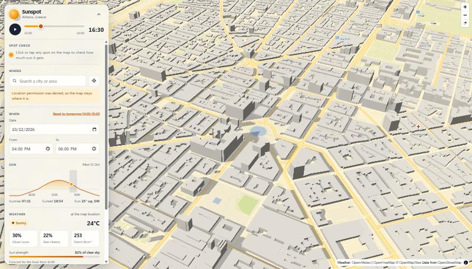
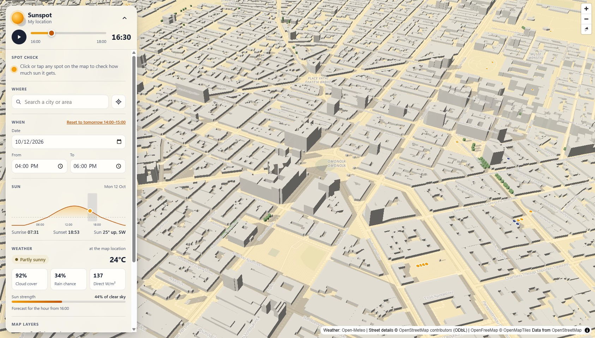
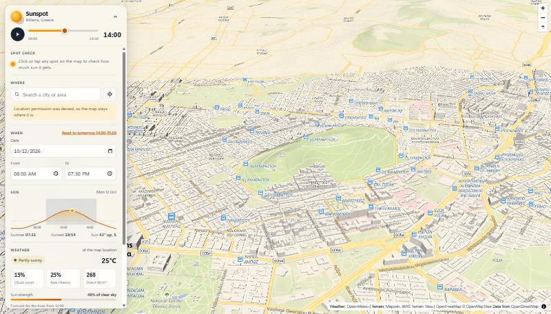
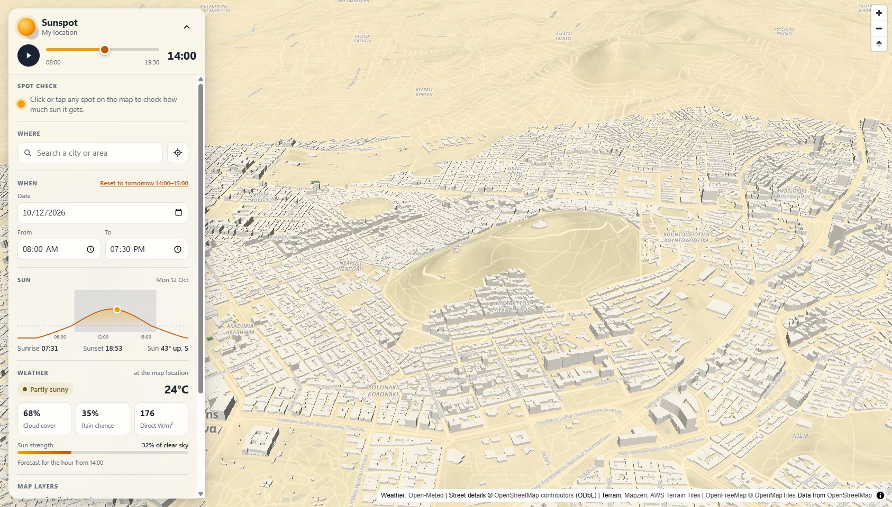

# Sunspot

A sunlight planner on a 3D map. Pick a place, a date and a time window, and
Sunspot shows where building shadows fall during that window, what the weather
forecast says, and whether a spot you click gets direct sun.

It runs entirely in the browser. There is no backend, no API key and no paid
service, so it costs nothing to host.

## What it does

- 3D map with extruded buildings. It opens on your location, or on Athens if
  location access is unavailable. Search for any place, or use the locate button.
- Date and time-window inputs (default: tomorrow, 14:00 to 15:00). A slider
  steps through the window in 5-minute steps and can play as an animation.
- Building shadows drawn on the ground for the slider's time, recomputed for the
  buildings in view whenever the map stops moving. Shadows fade under cloud.
- Weather for the slider's hour: cloud cover, rain chance, direct radiation,
  temperature, a label (Sunny, Partly sunny, Overcast or Rainy) and the sun's
  strength compared with a clear sky.
- Click any spot for a result card with two numbers: **geometric sun** (minutes
  clear of building shadows) and **effective sun** (those minutes weighted by
  how much direct beam the weather lets through). It also shows the sun's
  altitude and bearing at the start and end, the weather label for each hour of
  the window, and a verdict such as "Clear of shadows for 40 of 60 min, but
  cloud cuts the sun to 28% of clear-sky strength, so the light is mostly
  diffuse: only about 11 min of direct sun."
- Sunrise, sunset and the sun's height through the day.
- **Street details** from OpenStreetMap: trees that cast shadows, street lamps,
  and benches coloured by whether they are in sun or shade at the chosen time.
- Optional map layers, remembered between visits: a warm **sunlight overlay** on
  sunlit ground, and **3D terrain** with hillshade.
- A quiet basemap with no shop or restaurant icons, a sky that follows the time
  of day, and building light that comes from where the sun actually is.

| Before | After |
| --- | --- |
|  |  |
|  |  |

Same two views before and after the map polish: Omonia at 16:30 with the
sunlight overlay on, and Lycabettus hill at 14:00 with 3D terrain on.

## How it works

| Part | Source |
| --- | --- |
| Map rendering | [MapLibre GL JS](https://maplibre.org/) |
| Tiles and style | [OpenFreeMap](https://openfreemap.org/) "liberty" style, OpenMapTiles schema, data from OpenStreetMap |
| Sun position | [suncalc](https://github.com/mourner/suncalc) |
| Terrain (optional) | [AWS Terrain Tiles](https://registry.opendata.aws/terrain-tiles/), Mapzen terrarium elevation tiles |
| Forecast | [Open-Meteo forecast API](https://open-meteo.com/en/docs) |
| Place search | [Open-Meteo geocoding API](https://open-meteo.com/en/docs/geocoding-api) |
| Geometry | [turf](https://turfjs.org/) (union, point-in-polygon) |

### Shadow maths

Shadows are computed in the app (`src/lib/sun.ts`, `src/lib/shadow.ts`); no
shadow plugin is involved. Buildings are treated as flat-roofed prisms standing
on flat ground.

1. **Sun direction.** SunCalc 1.x reports azimuth measured from **south**,
   positive toward the west, in radians. A compass bearing starts at north and
   runs clockwise, so

   ```
   sunBearing = (azimuth in degrees + 180) mod 360
   ```

   suncalc is pinned to 1.9.0 because 2.x changed this convention (north-based
   degrees). A unit test checks the conversion, and another checks that the
   Athens sun is in the east in the morning and the south at noon.

2. **Shadow length.**

   ```
   length = height / tan(altitude)
   ```

   capped at 300 m when the sun is very low. If the altitude is zero or
   negative, there is no shadow.

3. **Shadow direction.** Directly away from the sun:
   `shadowBearing = sunBearing + 180`. The tip of the shadow is displaced
   `length * sin(shadowBearing)` metres east and `length * cos(shadowBearing)`
   metres north, converted to degrees with a local flat-earth approximation.

4. **Shadow polygon.** The shadow of a prism is its footprint swept along that
   displacement. That equals the footprint plus one quad per *leading* wall (a
   wall facing the way the shadow falls), swept along the displacement. Trailing
   walls and the translated roof outline add nothing, because any shaded point
   outside the footprint is reached through a leading wall. For convex
   footprints the convex hull of the footprint and its translated copy gives the
   same shape and is used as a fast path; concave footprints use the turf union
   of the pieces.

5. **Building height.** `render_height` or `height` from the tiles, else
   `levels * 3 m`, else a 12 m fallback (`FALLBACK_BUILDING_HEIGHT_M`).

6. **Point in shade.** A point is shaded if it is inside any building's shadow
   polygon, ignoring the building the point itself stands in. In code this is
   tested without building the polygon: the point is shaded when a line from it
   toward the sun, as long as the shadow, touches the footprint. A test checks
   that both give the same answer. The click analysis
   samples the window every 5 minutes; each sample is direct sun, building shade,
   or sun below the horizon (counted as no sun).

### Drawing the shadows

Merging every shadow in view with a polygon union takes a second or more per
frame in a dense city, which is too slow for the slider. So the map layer draws
the un-merged shadow pieces as a **zero-height `fill-extrusion` layer** instead
of a plain `fill` layer: MapLibre paints each pixel of a translucent extrusion
layer once, so overlapping shadows do not stack into darker patches. The result
looks like a flat fill. Exact per-building polygons (with the union) are still
used for the click analysis, where only nearby buildings matter.

Shadows are drawn from zoom 15 up, for at most 1,500 buildings and 1,500 trees
nearest the map centre. Which ones those are is worked out once per map move,
not per slider step. Measured on a desktop GPU (RTX 2060, 1686 x 960 window)
in central Athens with 185 trees and 118 benches loaded: about 41 ms per slider
step with street details and the overlay on, and 47 to 50 ms with 3D terrain on
as well.

### Cloud-aware sunlight (sunFactor)

Being clear of building shadows is not the same as being in the sun, so each
forecast hour gets a **sunFactor** between 0 and 1 (`src/lib/sunFactor.ts`):

```
sunFactor = forecast direct_radiation / clear-sky direct radiation
```

clamped to 0..1. The clear-sky value is an estimate for the sun's height at the
middle of that hour (Meinel model):

```
airMass      = 1 / sin(altitude)
directNormal = 1361 W/m2 * 0.7 ^ (airMass ^ 0.678)
clearSky     = directNormal * sin(altitude)      (on a horizontal surface)
```

If the forecast has no direct radiation, or the clear-sky value is under
30 W/m2 (sun below about 3 degrees, where the ratio is noise), the fallback is

```
sunFactor = 1 - cloud_cover / 100
```

sunFactor is used in four places:

- **Weather label.** Sunny, Partly sunny or Overcast by sunFactor alone (see the
  thresholds above).

- **Effective sun minutes.** Each 5-minute sample counts `5 * sunFactor` if it
  is clear of shadows and 0 otherwise. Forty unshaded minutes at sunFactor 0.3
  are 12 effective minutes.
- **Shadow darkness.** Shadow opacity scales with sunFactor (never below a
  quarter of full strength, so the geometry stays readable under cloud).
- **Sunlight overlay.** Its opacity scales with sunFactor too.

### Which forecast row each number comes from

Open-Meteo's hourly variables use two conventions, and `parseHourly` in
`src/lib/openMeteo.ts` reads each one so that it describes the hour starting at
the timestamp:

| Variable | Open-Meteo convention | Row read for the hour starting at row i |
| --- | --- | --- |
| `cloud_cover` | instantaneous at the timestamp | i |
| `temperature_2m` | instantaneous at the timestamp | i |
| `direct_radiation` | mean of the preceding hour | i + 1 |
| `shortwave_radiation` | mean of the preceding hour | i + 1 |
| `precipitation` | sum of the preceding hour | i + 1 |
| `precipitation_probability` | chance in the preceding hour | i + 1 |

So for "14:00" the radiation and rain figures cover 14:00 to 15:00, while cloud
cover and temperature are the values at 14:00. A unit test with a fixture pins
every variable to its row. The 23:00 hour has no following row on a one-day
request, so its radiation and rain are unknown and its sunFactor falls back to
cloud cover.

### Map layers and look

- **Sunlight overlay** (off by default). One warm yellow, translucent polygon
  over the whole map, placed just below the shadow layer. Shadows cover it, so
  only sunlit ground looks tinted. No polygon union is involved. Its opacity
  (`src/lib/overlay.ts`) is 0 when the sun is down, 0.12 when the sun is up
  under full cloud, and rises in a straight line to 0.35 at sunFactor 1.
- **3D terrain** (off by default). Elevation tiles drive both the terrain mesh,
  drawn at 1.5 times true height so city-scale relief is readable, and a
  hillshade layer lit from the sun's bearing. The tiles are requested only once
  the layer is switched on. Shadows are still computed for flat ground and are
  lifted 1.5 m so the terrain does not hide them.
- **Street details** (on by default). See the next section.
- **Sky and light.** The sky colours switch between day, golden hour and night,
  and buildings are lit from the sun's real bearing and height.
- The map renders at the screen's `devicePixelRatio`, and the camera can pitch
  up to 85 degrees.

The toggles are stored in `localStorage` (`sunspot:sunlight-overlay`,
`sunspot:terrain`, `sunspot:street-details`).

**Basemap.** The style is still OpenFreeMap "liberty", restyled after it loads
(`src/lib/basemap.ts`) so that shadows and sunlight are the visual focus:

- Every point-of-interest layer (shops, restaurants, offices) is hidden, along
  with one-way arrows, road shields and airport icons.
- Bus stops are hidden because they crowd a city centre. Rail and metro stations
  stay, small and pale.
- Street names stay, but smaller and low-contrast.
- Land, water, roads and rail are recoloured to light neutral tones.

### Street details from OpenStreetMap (Overpass API)

Benches, trees and street lamps come from OpenStreetMap through the public
[Overpass API](https://wiki.openstreetmap.org/wiki/Overpass_API)
(`src/lib/overpass.ts`). The query asks for three kinds of node inside a box:
`amenity=bench`, `natural=tree` and `highway=street_lamp`.

How they are drawn and used (`src/lib/furniture.ts`):

- **Trees** are a trunk and a canopy. Height comes from the `height` tag, else
  8 m; canopy radius is half of `diameter_crown`, else 3 m. The trunk is the
  lower 40% of the height.
- **Trees cast shadows** through the same pipeline as buildings. A canopy is a
  12-sided footprint floating between the trunk top and the tree top, so its
  shadow is that footprint swept from where the underside's shadow lands to
  where the top's shadow lands. Tree shade counts in the spot check too.
- **Lamps** are thin posts, 6 m unless tagged. They cast no shadow.
- **Benches** are dots: amber in the sun, blue in shade, grey when the sun is
  down, at the slider's time.

**Rate-limit etiquette.** The Overpass servers are free, shared and run by
volunteers. The app is built to ask rarely and ask small:

- Nothing is requested below zoom 16, or while the toggle is off.
- One request per map area, sent 600 ms after the map settles, so a string of
  pans and zooms costs one request.
- The request box is the view shrunk to at most 0.016 degrees per side around
  the centre (roughly 1.4 km by 1.8 km at Athens) and snapped to a 0.004 degree
  grid. Results are cached in memory by that box, so small pans reuse the cache.
- Responses are capped at 4,000 elements, with a 10 s server-side timeout.
- If the first server (`overpass-api.de`) fails or times out after 8 s, a second
  one (`overpass.openstreetmap.fr`) is tried once. There is no retry loop. If
  both fail, the toggle reads "Street details unavailable right now", whatever
  was already loaded stays on the map, and everything else keeps working.

Please keep it that way if you fork this: do not poll, prefetch or loop over
areas against the public servers. For heavy use, run your own Overpass instance.

**Coverage limits.** This shows what volunteers have mapped, not what exists.
Tree, bench and lamp coverage in OpenStreetMap is patchy and varies street by
street: in central Athens one request box returned 185 trees, 118 benches and
31 lamps, while many real trees and almost all lamps are missing. Tree height
and canopy size are rarely tagged, so most trees use the 8 m and 3 m defaults.
An area with no trees on the map is not necessarily a treeless area.

### Weather label thresholds

The label is derived from two numbers only: the hour's sunFactor (below) and its
rain chance. The thresholds are constants in `src/lib/weatherLabel.ts`, checked
in this order:

| Label | Rule |
| --- | --- |
| Rainy | rain chance >= 60% |
| Sunny | sunFactor >= 0.7 |
| Partly sunny | sunFactor >= 0.3 |
| Overcast | anything lower |

Because the label and the "sun strength" figure come from the same sunFactor,
they cannot disagree. Thin high cloud that covers the sky but lets most of the
beam through counts as sunny, and the cloud cover percentage is shown separately.

### Time zones

Dates and times are wall-clock values in the selected place's timezone (default
Europe/Athens). The timezone comes from the search result, or from Open-Meteo
for a location or clicked point. The forecast is requested with
`timezone=auto`, so its hours are already local. Local times are converted to
UTC instants only for the sun calculations (`src/lib/time.ts`).

### Caching

Forecast responses are cached in memory per (latitude, longitude, date), with
coordinates rounded to 0.01 degrees. The cache lasts until the page reloads.

## Setup

Requires Node.js 20 or newer.

```bash
npm install
npm run dev
```

Then open the URL Vite prints (http://localhost:5173 by default).

## Scripts

| Command | What it does |
| --- | --- |
| `npm run dev` | Start the dev server |
| `npm run build` | Type-check and build to `dist/` |
| `npm run preview` | Serve the production build locally |
| `npm test` | Run the unit tests once (Vitest) |
| `npm run test:watch` | Run the tests in watch mode |
| `npm run typecheck` | Type-check only |
| `npm run lint` | Lint with oxlint |

The tests cover the azimuth conversion, shadow length and direction, shadow
polygons, the point-in-shade test, the weather label rules, sunFactor and the
clear-sky estimate, effective sun minutes, the verdict wording, timezone
handling and the click analysis.

## Deployment to GitHub Pages

`.github/workflows/deploy.yml` tests, builds and deploys on every push to
`main`.

1. Push the repository to GitHub.
2. In the repository, open **Settings > Pages** and set **Source** to
   **GitHub Actions**.
3. Push to `main` (or run the workflow by hand from the **Actions** tab).

The site appears at `https://<user>.github.io/<repo>/`. The workflow passes the
repository name to Vite as `BASE_PATH`, which `vite.config.ts` uses for `base`,
so asset URLs are correct under that sub-path without editing any file. For a
custom domain or a user page served from `/`, remove the `BASE_PATH` line.

GitHub Pages is free for public repositories. For a private repository it needs
a paid GitHub plan.

## Known limitations

- **Heights are approximate.** OpenStreetMap building heights are incomplete.
  Where a height is missing, the tiles supply a default or an estimate from the
  number of levels, so shadow lengths are approximate.
- **Only buildings and mapped trees cast shadows.** Terrain (hills) and roof
  shapes are not modelled. Every building is a flat-roofed box on flat ground,
  and courtyards are treated as filled.
- **Trees are rough.** Only trees mapped in OpenStreetMap exist for the app,
  and only when street details are loaded (zoom 16 and closer). Each is a
  solid, round canopy of a default size unless tagged, so real dappled or
  seasonal shade is not captured.
- **Street details depend on a shared public service.** Overpass can be slow or
  unavailable; the app then simply shows no street details.
- **Roofs and upper floors.** Shade is computed at ground level. A marker placed
  on a building ignores that building.
- **sunFactor is an estimate.** The clear-sky model assumes clean air, and the
  forecast radiation is an hourly mean, so effective sun minutes are a guide,
  not a measurement.
- **Shadows assume flat ground, even with 3D terrain on.** The terrain layer
  only changes how the map is drawn. Shadow length and direction are still
  computed as if every building stood on a level plane at its own base, so on a
  slope a real shadow would be shorter (uphill) or longer (downhill) than the
  one shown. Hills themselves cast no shadow. The drawn shadows are flat sheets
  lifted 1.5 m above the terrain, so on steep ground parts of them can sink
  into, or float above, the surface. The spot check uses the same flat-ground
  maths whether terrain is on or off.
- **Tile edges.** A building cut by a tile boundary arrives in pieces. This does
  not change the drawn shadows but can slightly affect the click analysis at the
  seam.
- **The forecast is hourly and uncertain.** It covers 16 days, and cloud cover
  several days ahead is a rough guide. Shadows work for any date; weather does
  not.
- **Zoom.** Shadows and the click analysis need building outlines, which load
  from zoom 15. Very busy views shade only the nearest 1,500 buildings and
  1,500 trees, and track the nearest 400 benches.

## Attribution

Map data © [OpenStreetMap](https://www.openstreetmap.org/copyright)
contributors, available under the
[Open Database License (ODbL)](https://opendatacommons.org/licenses/odbl/). This
covers both the basemap and the street details (benches, trees, lamps) fetched
through the Overpass API. Tiles and style by [OpenFreeMap](https://openfreemap.org/)
(© OpenMapTiles). Weather and geocoding by [Open-Meteo](https://open-meteo.com/).
Terrain from [AWS Terrain Tiles](https://registry.opendata.aws/terrain-tiles/)
(Mapzen), built from the sources listed in the
[Tilezen Joerd attribution](https://github.com/tilezen/joerd/blob/master/docs/attribution.md).
